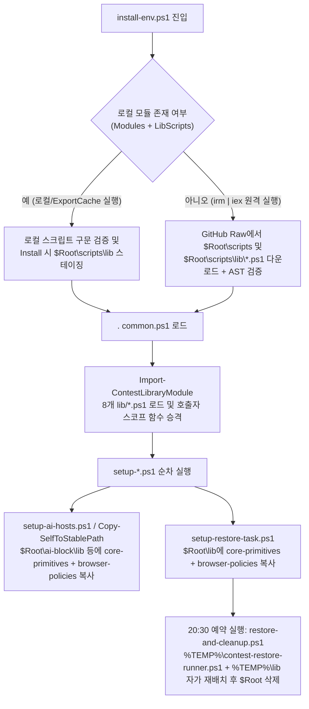

# ContestSetup v2.0 모듈 구조 및 아키텍처 가이드 (`docs/STRUCTURE.md`)

본 문서는 **ContestSetup v2.0** 저장소의 전체 디렉터리 레이아웃, 루트 오케스트레이션 스크립트(12종), `lib/` 공유 라이브러리 계층(8종), `tests/contestsetup_tests/` 검증 패키지(10종), 그리고 로컬·원격(`irm | iex`)·오프라인(`ExportCache`)·작업 스케줄러 실행 시의 모듈 로딩 및 스테이징 흐름을 정의합니다.

---

## 1. 계층형 아키텍처 개요

ContestSetup v2.0은 단일 거대 스크립트의 중복과 결합도를 제거하고 유지보수성과 검증 가능성을 극대화하기 위해 **3계층 모듈 아키텍처**로 설계되어 있습니다.

1. **루트 진입점 및 오케스트레이션 계층 (`/*.ps1`, 12개 파일)**
   - 사용자 CLI / `irm | iex` 진입점(`install-env.ps1`, `install-ai-hosts.ps1`), 설정 및 로더 허브(`common.ps1`), 단계별 프로비저닝 모듈(`setup-*.ps1`), 독립 실행 및 예약 작업용 차단/복원 엔진(`ai-hosts-block.ps1`, `restore-and-cleanup.ps1`)으로 구성됩니다.
2. **공유 도메인 라이브러리 계층 (`/lib/*.ps1`, 8개 파일, 각 600줄 미만)**
   - UTF-8 무-BOM 입출력, JSONC 파서, Win32 인자 이스케이프, 상태 매니페스트, KST 시험 일정 검증, 병렬 다운로드/해시/서명 검증, 사용자 SID 기반 레지스트리 PATH 관리, 환경 감사, 22개 브라우저 DoH/AI 정책 명세, VS Code 격리 워크스페이스/바로가기 관리 등 모든 핵심 로직의 **단일 진실 공급원(Single Source of Truth)** 역할을 수행합니다.
3. **모듈형 정적·시뮬레이션·실행 검증 계층 (`/tests/`, 진입점 200줄 미만 + 패키지 9개 모듈)**
   - AST/바이트 검사기(`inspector.py`), 핵심 알고리즘 시뮬레이터(`simulator.py`), Tier 1~5 테스트 모듈, 그리고 실제 `pwsh 7.4+` 프로세스에서 PowerShell 함수를 직접 호출해 검증하는 Live E2E 스위트(`live_pwsh_e2e.py`)로 분리되어 총 291개 테스트를 수행합니다.

---

## 2. 디렉터리 레이아웃

```text
ContestSetup/
├── install-env.ps1                  # 메인 오케스트레이터 (Install/Status/Verify/Restore/DryRun/ExportCache)
├── common.ps1                       # 전역 설정 허브 및 Import-ContestLibraryModule 로더 (< 300줄)
├── setup-msys2.ps1                  # [Step 2/8] MSYS2 UCRT64 (gcc, g++, gdb, cat) 설치 및 오프라인 시딩
├── setup-python.ps1                 # [Step 3/8] 격리 Python 3.10.11 및 네이티브 python3.exe 프로비저닝
├── setup-visualstudio.ps1           # [Step 4/8] 기존 MSVC 감지(vswhere) 및 선택적 VS 2022 설치
├── setup-vscode.ps1                 # [Step 5/8] 포터블 VS Code, 확장 허용목록, AI 차단 설정 및 마켓플레이스 잠금
├── setup-wrappers.ps1               # [Step 6/8] g++14/17/20 래퍼 생성, 비음영 PATH 순서 구성 및 스모크 테스트
├── setup-ai-hosts.ps1               # [Step 7/8] AI 도메인 차단 스크립트 스테이징 및 즉시/지연 적용 연동
├── setup-restore-task.ps1           # [Step 8/8] 시험 시작(19:00) 및 종료 복원(20:30) Windows 예약 작업 등록
├── install-ai-hosts.ps1             # 단독 AI 차단/복원 원격 부트스트래퍼 (irm | iex 지원)
├── ai-hosts-block.ps1               # IPv4 + IPv6 + www AI 도메인 hosts 차단 및 브라우저 DoH/AI 정책 엔진
├── restore-and-cleanup.ps1          # 시험 종료 후 전체 환경 복원, 답안 백업 및 안전한 자가 삭제 엔진
├── lib/                             # 공유 PowerShell 도메인 라이브러리 계층 (8개 모듈, 각 < 600줄)
│   ├── core-primitives.ps1          # 핵심 입출력, UTF-8 no-BOM, JSONC 파서, Win32 인자 쿼팅, 경로 유틸리티
│   ├── logging-and-manifest.ps1     # 트랜스크립트/오류 로깅 및 install-manifest.json 체크포인트 관리
│   ├── schedule-and-preflight.ps1   # KST(+09:00) 일정 파서, HTTPS 시계 오차 점검, 사전 환경 검사(Preflight)
│   ├── download-and-archive.ps1     # 3단계 고속 압축 해제, 캐시 검증, 병렬 다운로드, SHA256/Authenticode/winget
│   ├── path-and-identity.ps1        # 학생 SID/프로필 해석, HKU\<SID>\Environment REG_EXPAND_SZ PATH 관리 및 백업
│   ├── environment-audit.ps1        # 무변경(Read-Only) 대회 환경 감사 엔진 (Status / Verify / DryRun 공유)
│   ├── browser-policies.ps1         # 22개 브라우저 DoH 및 AI 차단 레지스트리 정책 명세 단일 진실 공급원
│   └── vscode-workspace.ps1         # VS Code 바로가기(.lnk) 매니페스트, 런처, CLI 래퍼, 기본 워크스페이스 생성
├── docs/
│   └── STRUCTURE.md                 # 저장소 모듈 아키텍처 및 데이터 흐름 문서 (본 문서)
├── tests/
│   ├── run_tests.py                 # 경량 CLI 테스트 러너 진입점 (< 200줄)
│   └── contestsetup_tests/          # 모듈형 검증 스위트 패키지 (291개 테스트)
│       ├── __init__.py              # 공통 상수(PS1_FILES, EXPECTED_LIB_PS1_FILES), TestCase 모델 및 스위트 빌더
│       ├── inspector.py             # PowerShellInspector (lib/ 확장 유효 코드 해석, 7-bit ASCII/구문 균형 검증)
│       ├── simulator.py             # BehavioralSimulator (쿼팅, JSONC, KST 일정, 브라우저 정책, 백업 시뮬레이션)
│       ├── tier1_features.py        # Tier 1: 23개 핵심 기능별 단위 검증 (100개 테스트)
│       ├── tier2_boundaries.py      # Tier 2: 경계값, 오류 복구 및 보안 가드 검증 (100개 테스트)
│       ├── tier3_contracts.py       # Tier 3: 스크립트 간 파라미터·매니페스트·정책 정합성 계약 검증 (34개 테스트)
│       ├── tier4_scenarios.py       # Tier 4: 대회 운영 종단간 라이프사이클 시나리오 검증 (16개 테스트)
│       ├── tier5_adversarial.py     # Tier 5: 적대적 변이·인젝션·동시성·PS 5.1 AST 감사 (34개 테스트, T5_01~T5_34)
│       └── live_pwsh_e2e.py         # Tier 5 확장: Live pwsh 7.4+ 실제 함수 실행 E2E 및 구조 게이트 (7개 테스트, T5_35~T5_41)
├── README.md                        # 사용자 설치·운영 매뉴얼
├── ARCHITECTURE_V2.md               # v2.0 아키텍처 설계 및 안정성 결함 해결 명세 (S-01~S-28, O1~O10)
├── PROJECT.md                       # 프로젝트 요구사항, CLI 파라미터/환경변수 규약 및 불변 조건
└── TEST_INFRA.md                    # 5계층 테스트 인프라 명세서
```

---

## 3. 루트 PowerShell 스크립트 계층 (`/*.ps1`, 12종)

| 파일명 | 역할 및 주요 책임 | 참조하는 `lib/` 모듈 |
| :--- | :--- | :--- |
| `install-env.ps1` | 전체 라이프사이클(`Install`, `Status`, `Verify`, `Restore`, `DryRun`, `ExportCache`) 진입점. 21개 CLI 파라미터 및 `CONTEST_*` 환경변수 바인딩, UAC 권한 승격 전 학생 SID 캡처, `Global\ContestSetupEnvironmentMutex` 획득, 로컬/원격 스크립트 및 `$LibScripts` 스테이징 수행 | `common.ps1`을 통해 핵심 `lib/*.ps1` 로드 및 `$LibScripts` 8종 직접 스테이징/번들링 |
| `common.ps1` | 전역 설정 허브(`< 300`줄). `Set-StrictMode -Version 2.0`, UTF-8 콘솔 인코딩, `Get-ContestVariableValue`(얕은 호출 스택 안전 가드 포함), 대회 기본 일정(`2026-11-23T19:00:00`~`20:30:00`), 도구 경로 상수 초기화 후 `Import-ContestLibraryModule`로 공유 라이브러리 로드 | `core-primitives.ps1`, `logging-and-manifest.ps1`, `schedule-and-preflight.ps1`, `download-and-archive.ps1`, `path-and-identity.ps1`, `environment-audit.ps1`, `browser-policies.ps1`, `vscode-workspace.ps1` |
| `setup-msys2.ps1` | MSYS2 UCRT64(`gcc`, `g++`, `gdb`, `cat`) 설치, KAIST/Harukasan 미러 우선순위 구성, 커스텀/Windows 루트 CA 인증서 주입(`.contest-bak` 보존), 오프라인 패키지 캐시 시딩 및 2단계 `SyncFirst` 복구 수행 | `common.ps1` 세션 컨텍스트 공유 |
| `setup-python.ps1` | 시스템 Python과 충돌하지 않는 격리 `$Root\Python310` 설치(공식 EXE 인스톨러 + NuGet 포터블 폴백), `python310._pth`의 `import site` 복구, 네이티브 `python3.exe` 생성 및 `PythonInstalledByContestSetup` 기록 | `common.ps1` 세션 컨텍스트 공유 |
| `setup-visualstudio.ps1` | `vswhere.exe`로 기존 MSVC(`cl.exe`) 유무를 감지하고, `-IncludeVisualStudio` 지정 시에만 VS 2022 Community C++ 워크로드를 무인 설치 | `common.ps1` 세션 컨텍스트 공유 |
| `setup-vscode.ps1` | 독립형 포터블 VS Code(`$Root\vscode`) 압축 해제, 이중 격리 프로필(`$Root\vscode-contest` + `$Root\vscode\data` 포터블 트랩), 필수 확장 일괄/재시도 설치, 비허용/AI 확장 디렉터리 소거, 한국어 로케일 및 AI 숨김 설정, `product.json` 마켓플레이스 잠금 수행 | `core-primitives.ps1`, `download-and-archive.ps1`, `vscode-workspace.ps1` |
| `setup-wrappers.ps1` | `@setlocal` 기반 명령어 래퍼(`g++14.cmd`, `g++17.cmd`, `g++20.cmd` 등) 생성, 네이티브 `.exe` 우선 사용자 PATH 배치, C++14/17/20 및 Python 컴파일·실행 스모크 테스트 수행 | `common.ps1` 세션 컨텍스트 공유 |
| `setup-ai-hosts.ps1` | 설치 파이프라인 중 `ai-hosts-block.ps1`과 필수 `lib/` 모듈을 `$Root`, `$Root\ai-block`, `$Root\ai-hosts-block`에 스테이징하고, `-DeferAiBlockUntilExamStart` 여부에 따라 즉시 적용 또는 19:00 예약 적용 준비 | `core-primitives.ps1`, `browser-policies.ps1` 스테이징 연동 |
| `setup-restore-task.ps1` | `restore-and-cleanup.ps1`과 필수 `lib/` 모듈을 `$Root`에 스테이징하고, 시험 시작 강제 작업(`ContestSetupExamStartEnforcement`, 19:00) 및 시험 종료 자동 복원 작업(`ContestSetupRestoreAndCleanup`, 20:30, `SYSTEM S-1-5-18` 우선) 등록 | `core-primitives.ps1`, `browser-policies.ps1` 스테이징 연동 |
| `install-ai-hosts.ps1` | `ai-hosts-block.ps1`만 단독으로 실행할 때 사용하는 경량 부트스트래퍼(`irm | iex` 지원). `%TEMP%\contest-env-installer`에 본체와 필수 `lib/` 모듈을 준비한 뒤 관리자 권한으로 위임 실행 | `core-primitives.ps1`, `browser-policies.ps1` 부트스트랩 |
| `ai-hosts-block.ps1` | 약 300개 이상으로 확장되는 AI 도메인(IPv4 `0.0.0.0` + IPv6 `::` + `www.` 자동 확장)을 Windows `hosts` 파일에 멱등적으로 적용/복원하고, 22개 브라우저 DoH/AI 레지스트리 정책 잠금·백업·복원 및 단독 자동 복원 예약(`ContestSetupRestoreAiHostsBlock`)을 수행 | `core-primitives.ps1`, `browser-policies.ps1` |
| `restore-and-cleanup.ps1` | 대회 종료 시 예약 작업 해제, VS Code 바로가기 복원(또는 `-KeepVSCode` 시 마켓플레이스 잠금 해제), 스냅샷 기반 사용자/머신 PATH 및 MSYS2 설정 복원, hosts/브라우저 정책 복원, 대회용 Python 안전 제거, 학생 소스코드(`<= 5MB`) 백업 및 `%TEMP%` 자가 재배치를 통한 `$Root` 완전 삭제 수행 | `core-primitives.ps1`, `browser-policies.ps1` |

---

## 4. `lib/` 공유 도메인 라이브러리 계층 (`/lib/*.ps1`, 8종)

모든 `lib/*.ps1` 파일은 단독 로드 시에도 안전하도록 최상단에 `Set-StrictMode -Version 2.0`, `$ErrorActionPreference = 'Stop'`, `$global:PSNativeCommandUseErrorActionPreference = $false`를 선언하며, 각각 **600줄 미만**으로 유지됩니다.

### 4.1 `lib/core-primitives.ps1`
모든 스크립트가 공통으로 사용하는 입출력·문자열·JSONC·경로 기본 함수를 제공합니다.
- **콘솔/프로세스/권한**: `Write-Section`, `Test-CommandExists`, `Test-IsAdmin`, `Get-PreferredPowerShell`, `Quote-ProcessArgument` (Win32 `CommandLineToArgvW` 역슬래시·따옴표 규칙 완벽 준수)
- **UTF-8 무-BOM 파일 입출력**: `Write-TextUtf8NoBom`, `Write-LinesUtf8NoBom`, `Write-JsonUtf8NoBom` (`ConvertTo-Json -InputObject` 사용으로 PS 5.1 단일 원소 배열 언래핑 방지), `Read-TextUtf8`, `Read-LinesUtf8`
- **강건한 JSONC 파싱 및 객체 조작**: `Strip-JsonComments` (다중 BOM, `//` 및 `/* */` 주석, 후행 쉼표 안전 제거), `ConvertFrom-JsonSafe`, `ConvertFrom-JsonArray`, `Set-ObjectProperty`
- **경로 정규화 및 VS Code 레이아웃 해석**: `Resolve-VSCodeProductJsonPath` (레거시 플랫 구조 및 VS Code 1.97+ `<commit>\resources\app\product.json` 지원), `Test-PathInside` (경계 구분자 검증으로 `C:\CPTools_Backup` 오탐 차단), `Convert-ToForwardSlashPath`, `Normalize-PathForCompare`

### 4.2 `lib/logging-and-manifest.ps1`
설치 로그 보존과 재개 가능한 상태 체크포인트(`$Root\state\install-manifest.json`)를 전담합니다.
- **로깅**: `Start-SetupLogging`, `Stop-SetupLogging`, `Backup-SetupLogsToTemp`, `Write-ErrorLog`
- **상태 매니페스트**: `New-DefaultContestStateManifest`, `Read-ContestStateManifest`, `Get-ContestStateManifest`, `Save-ContestStateManifest`, `Update-ContestStateManifest` (`CompletedModules`, `TargetUserSid`, `TargetUserProfile`, `MsysRoot`, `PythonInstalledByContestSetup` 등 기록)

### 4.3 `lib/schedule-and-preflight.ps1`
한국 표준시(KST, `UTC+09:00`) 기준 시험 일정 검증과 설치 전 시스템 상태 점검을 담당합니다.
- **제공 함수**: `ConvertTo-KstDateTimeOffset`, `Test-ExamScheduleConfiguration`, `Clear-StaleAiHostsSectionBeforeInstall`, `Test-SystemClockSkewHttps`, `Invoke-PreflightChecks`
- **핵심 불변 조건**: 비-KST 시간대나 비-그레고리력 로케일에서도 `InvariantCulture`와 `+09:00` 오프셋 정규화로 정확한 시각을 산출하며, 설치 재실행 시 이전 AI hosts 차단이 다운로드 도메인을 막지 않도록 사전 정리합니다.

### 4.4 `lib/download-and-archive.ps1`
네트워크 다운로드, 오프라인 캐시 재사용, 무결성 검증 및 패키지 매니저 호출을 담당합니다.
- **아카이브 및 네이티브 실행**: `Expand-ArchiveFast` (`System32\tar.exe` -> `.NET ZipFile` -> `Expand-Archive` 3단계 폴백 및 병합 오염 방지 사전 클린업), `Invoke-NativeCommand`, `Invoke-NativeChecked`
- **캐시·다운로드·무결성**: `Test-ValidCachedInstallerFile` (최소 크기 및 `MZ`/`PK` 매직 바이트 검사로 캡티브 포털 HTML 오염 차단), `Copy-FromCacheDirIfPresent`, `Invoke-DownloadFile`, `Assert-FileSha256`, `Assert-AuthenticodeValid`, `Download-VerifiedFile`, `Invoke-ParallelDownloadFiles` (`HttpClient` + `CopyToAsync` + `Task.WhenAll` 비동기 병렬 프리페치)
- **Winget 래퍼**: `Test-WingetHelpSupports`, `Invoke-Winget`, `Install-ByWinget`, `Uninstall-WingetPackageIfExists`, `Update-WingetClient`

### 4.5 `lib/path-and-identity.ps1`
관리자 승격(UAC) 또는 `SYSTEM(S-1-5-18)` 컨텍스트에서도 실제 수험생 계정을 정확히 식별하고 `REG_EXPAND_SZ`를 보존하며 PATH를 조작합니다.
- **사용자 식별 및 환경 브로드캐스트**: `Broadcast-EnvironmentChange` (`WM_SETTINGCHANGE`), `Resolve-ContestTargetUser` (명시적 SID -> 상태 매니페스트 -> 활성 `explorer.exe` 소유자 -> 현재 사용자 순 해석)
- **레지스트리 PATH 읽기/쓰기 및 백업**: `Get-RawMachinePath`, `Set-RawMachinePath`, `Get-UserPathForTargetUser`, `Set-UserPathForTargetUser` (`HKU\.DEFAULT` 오염 원천 차단 및 미마운트 `NTUSER.DAT` 임시 하이브 로드 지원), `Add-UserPathFront`, `Add-UserPathsFront`, `Remove-PathEntriesMatching`, `Remove-ConflictingPathEntries`, `Backup-PathEnvironment`, `Get-PathHashToken`, `Backup-PathVerified`, `Backup-And-RemovePathSafe`

### 4.6 `lib/environment-audit.ps1`
시스템을 일절 변경하지 않는 순수 읽기 전용(Read-Only) 감사 엔진을 제공합니다.
- **제공 함수**: `Invoke-ContestEnvironmentAudit`
- **점검 항목**: MSYS2 컴파일러/디버거, 격리 Python 3.10 및 `python3.exe`, 포터블 VS Code 본체, 필수 확장 4종 및 허용목록 외 확장 부재 여부, `product.json` 마켓플레이스 `https://127.0.0.1` 잠금 여부, `hosts` 파일 내 활성 차단 규칙 수(`CONTEST_HOSTS_PATH_OVERRIDE` 테스트 오버라이드 지원), 예약 작업 등록 상태(`Status` vs `Verify` 판정 분리)를 종합 진단합니다.

### 4.7 `lib/browser-policies.ps1`
브라우저 DNS-over-HTTPS(DoH) 우회 차단 및 내장 AI 기능 비활성화를 위한 레지스트리 정책 명세의 단일 진실 공급원입니다.
- **제공 함수**:
  - `Get-BrowserPolicySpecifications`: Chrome, Edge, Brave, Naver Whale, Firefox DoH 차단 및 Windows/Edge Copilot 비활성화 핵심 정책 **13개**
  - `Get-ExtendedBrowserPolicySpecifications`: DoH 템플릿 초기화 및 브라우저 내장 생성형 AI 모델 비활성화 확장 정책 **9개**
- **공유 소비자**: `ai-hosts-block.ps1`(정책 적용 및 백업 복원)과 `restore-and-cleanup.ps1`(폴백 복원)이 동일한 명세 함수를 호출하여 22개 정책 키/타입/값의 100% 일치를 보장합니다.

### 4.8 `lib/vscode-workspace.ps1`
수험생 데스크톱/시작 메뉴 바로가기 교체와 C++/Python 기본 디버깅 워크스페이스 생성을 담당합니다.
- **바로가기 및 매니페스트**: `Convert-PathToSafeFileName`, `Get-TargetStudentShortcutFolders`, `Get-StandardVSCodeShortcutCandidates`, `Get-VSCodeShortcutTargets`, `Read-VSCodeShortcutManifest`, `Write-VSCodeShortcutManifest`, `Get-VSCodeShortcutManifestItem`, `Set-ContestVSCodeShortcut`, `Restore-NormalVSCodeShortcut`
- **런처 및 워크스페이스 템플릿**: `New-ContestVSCodeLauncher`, `New-ContestVSCodeCliWrapper`, `Set-ContestVSCodeWorkspaceDefaults` (`tasks.json`, `launch.json`, `c_cpp_properties.json` UTF-8 무-BOM 생성)

---

## 5. 모듈 로딩, 스테이징 및 자가 재배치 데이터 흐름

ContestSetup은 로컬 저장소 실행뿐만 아니라 단일 명령 원격 실행(`irm .../install-env.ps1 | iex`), 오프라인 USB 캐시 설치(`-CacheDir` / `-Mode ExportCache`), 그리고 `$Root` 폴더 삭제를 수반하는 예약 복원 작업까지 모두 지원해야 합니다. 이를 위해 다음과 같은 일관된 모듈 해석 체인을 사용합니다.



1. **`Import-ContestLibraryModule` 탐색 우선순위**
   - `common.ps1`, `setup-vscode.ps1`, `ai-hosts-block.ps1`, `restore-and-cleanup.ps1`에 정의된 로더는 다음 순서로 `lib/<ModuleName>`을 탐색합니다:
     1. `$PSScriptRoot\lib\<ModuleName>`
     2. `(Split-Path -Parent $PSCommandPath)\lib\<ModuleName>`
     3. `$env:CONTEST_LIB_DIR\<ModuleName>`
     4. `$ScriptStageDir\lib\<ModuleName>` (`$Root\scripts\lib`)
     5. (단독 실행 스크립트의 경우) `$Root\lib`, `$Root\scripts\lib`, `$Root\ai-block\lib`
     6. `(Get-Location).Path\lib\<ModuleName>`
   - 모듈 파일을 찾으면 도트 소싱(`. $Candidate`)한 뒤 PowerShell AST에서 최상위 `FunctionDefinitionAst`를 추출하여 `Function:\script:<Name>`에 바인딩함으로써 호출자 스크립트 스코프에 함수를 안전하게 노출합니다.
2. **오프라인 캐시 번들링 (`-Mode ExportCache`)**
   - `install-env.ps1 -Mode ExportCache` 실행 시 루트 스크립트들과 함께 `$LibScripts` 8종 전부가 `<ExportRoot>\scripts\lib\*.ps1` 아래에 그대로 복제되어, 폐쇄망/USB 환경에서도 `<ExportRoot>\scripts\install-env.ps1`만으로 100% 동일하게 동작합니다.
3. **예약 작업 및 `%TEMP%` 자가 재배치 시의 독립성 보장**
   - `ai-hosts-block.ps1`의 `Copy-SelfToStablePath`와 `setup-ai-hosts.ps1`은 `$Root\ai-block\lib\`, `$Root\ai-hosts-block\lib\`, `$Root\lib\`에 `core-primitives.ps1`과 `browser-policies.ps1`을 함께 복사합니다.
   - `restore-and-cleanup.ps1`은 `$Root` 내부에서 실행될 때 파일 핸들 잠금을 피하기 위해 자신을 `%TEMP%\contest-restore-runner.ps1`로 복제하면서 `%TEMP%\lib\`에도 `core-primitives.ps1`과 `browser-policies.ps1`을 함께 복제한 뒤 재실행(`-ReinvokedFromTemp`)합니다.

---

## 6. 테스트 인프라 모듈 구조 (`tests/`)

단일 거대 스크립트였던 테스트 러너는 유지보수성과 계층별 책임 분리를 위해 경량 CLI 진입점(`tests/run_tests.py`)과 `tests/contestsetup_tests/` 패키지로 분해되어 있습니다.

| 파일 경로 | 핵심 역할 및 검증 범위 |
| :--- | :--- |
| `tests/run_tests.py` | `< 200`줄 CLI 진입점. `--tier 1\|2\|3\|4\|5\|all`, `-v`/`--verbose`, `--json`, `--strict` 옵션을 처리하고 테스트 실행 요약 및 종료 코드를 반환 |
| `tests/contestsetup_tests/__init__.py` | `PS1_FILES`(루트 12종), `EXPECTED_LIB_PS1_FILES`(`lib/` 8종), `INSTALL_ENV_21_PARAMS`, `TestCase`/`TestSkipped` 모델, `find_pwsh()`, `build_test_suite()` 정의 |
| `tests/contestsetup_tests/inspector.py` | `PowerShellInspector`: 물리 파일 읽기(`read_bytes`, `read_text`)와 최상위 `Import-ContestLibraryModule` 문을 순환 안전하게 인라인 확장하는 `read_effective_text`, 주석 제거 코드 추출(`read_active_code`), 히어스트링/주석 내 중괄호에 안전한 함수 본문 추출기(`extract_function_body`), 7-bit ASCII/무-BOM/구문 균형/파라미터 셋 검증기 제공 |
| `tests/contestsetup_tests/simulator.py` | `BehavioralSimulator`: PowerShell 소스에서 정규식·상수를 직접 추출하여 결합 검증하는 Win32 인자 쿼팅, JSONC 파싱, KST 일정 계산, hosts 섹션 편집, 브라우저 22개 정책 튜플 파싱, 안전 경로 검증 및 답안 백업 시뮬레이터 |
| `tests/contestsetup_tests/tier1_features.py` | **Tier 1 (100개 테스트)**: F1~F23 전체 기능 요구사항에 대한 정적·동작 단위 검증 |
| `tests/contestsetup_tests/tier2_boundaries.py` | **Tier 2 (100개 테스트)**: 드라이브 루트 삭제 방지, 손상된 JSON/매니페스트 복구, 비-KST 시간대, 권한 분리 등 경계 조건 검증 |
| `tests/contestsetup_tests/tier3_contracts.py` | **Tier 3 (34개 테스트)**: 21개 CLI 파라미터/환경변수 4자 동기화, 6개 스크립트 간 호출 간선 AST 검증, 22개 브라우저 정책 패리티(`T3_25`), VS Code 1.97+ 경로 해석 계약 검증 |
| `tests/contestsetup_tests/tier4_scenarios.py` | **Tier 4 (16개 테스트)**: 사전 배포, 시험 진행, 오프라인 캐시 시딩, 지연 차단, 시험 종료 후 복원 등 종단간 대회 운영 시나리오 검증 |
| `tests/contestsetup_tests/tier5_adversarial.py` | **Tier 5 기본 (34개 테스트, `T5_01`~`T5_34`)**: 퍼징, 캡티브 포털 캐시 오염 방어, `HKU\.DEFAULT` 쓰기 금지, 뮤텍스 데드락 방지, 얕은 스코프 `irm \| iex` 회귀(`T5_33`), 전 스크립트 PS 5.1 호환성 및 스위치 바인딩 AST 감사(`T5_34`) |
| `tests/contestsetup_tests/live_pwsh_e2e.py` | **Tier 5 Live E2E (7개 테스트, `T5_35`~`T5_41`)**: 실제 `pwsh` 런타임에서 `common.ps1` + `lib/*` + `Invoke-ContestEnvironmentAudit`(`T5_35`), `setup-vscode.ps1`(`T5_36`), `setup-wrappers.ps1`(`T5_37`), 오프라인 설치 파일/MSYS2 패키지 캐시 검증 및 시딩(`T5_38`), `ai-hosts-block.ps1`(`T5_39`), `restore-and-cleanup.ps1`(`T5_40`)을 직접 실행 검증하고, 모듈 라인 수 상한 및 중복 제로 아키텍처 계약(`T5_41`)을 강제 |

---

## 7. 모듈 경계 및 불변 엔지니어링 규칙

새로운 기능을 추가하거나 기존 모듈을 수정할 때는 다음 아키텍처 경계와 불변 조건을 반드시 준수해야 합니다.

1. **인코딩 및 문자셋 불변 조건 (PS 5.1 파서 보호)**
   - 루트 `*.ps1` 12종과 `lib/*.ps1` 8종(총 20개 PowerShell 파일)은 **100% 순수 7-bit ASCII(`0x00`~`0x7F` 미만)**, **UTF-8 무-BOM**, **LF(`\n`) 줄바꿈**만을 사용해야 합니다. 한글이나 유니코드 스마트 따옴표가 `.ps1` 소스에 들어가면 무-BOM 상태에서 한국어 Windows(CP949) PowerShell 5.1 파서가 구문 오류를 일으킵니다.
2. **단일 진실 공급원(Single Source of Truth) 및 중복 금지**
   - JSONC 파서(`Strip-JsonComments`, `ConvertFrom-JsonSafe`, `ConvertFrom-JsonArray`), UTF-8 입출력 함수, `Quote-ProcessArgument`, `Resolve-VSCodeProductJsonPath`, `Test-PathInside`는 오직 `lib/core-primitives.ps1`에만 정의합니다.
   - 22개 브라우저 정책 명세는 오직 `lib/browser-policies.ps1`에만 정의합니다.
   - VS Code 바로가기 매니페스트 및 기본 워크스페이스 생성 로직은 오직 `lib/vscode-workspace.ps1`에만 정의합니다.
3. **모듈 크기 상한 게이트 (`T5_41` 강제)**
   - 모든 `lib/*.ps1` 모듈: **600줄 미만**
   - `common.ps1`: **300줄 미만**
   - `tests/run_tests.py`: **200줄 미만**
4. **Windows PowerShell 5.1 & PowerShell 7.4+ 양방향 호환성**
   - PowerShell 7 전용 연산자(`?:`, `??`, `?.`, `&&`, `||`) 사용을 금지합니다.
   - 스위치 파라미터 뒤에 공백으로 구분된 위치 인자를 두지 않습니다(PS 5.1 바인딩 오류 방지).
   - `ConvertTo-Json` / `ConvertFrom-Json`을 파이프라인(`|`)으로 호출하지 않고 항상 `-InputObject` 또는 `Write-JsonUtf8NoBom` / `ConvertFrom-JsonSafe` / `ConvertFrom-JsonArray`를 사용합니다.
